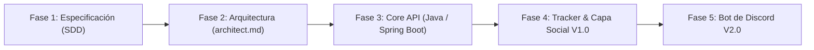

#  Amane 

> **Un tracker de anime minimalista y centrado en el descubrimiento, recomendaciones entre amigos y seguimiento de novedades.**

[-8A2BE2)](./specs/requirements.md)

---

##  Acerca de Amane

**Amane** nace de la inspiración en herramientas ligeras y directas como *Trackma*, pero dando un paso adelante en una de las mayores necesidades de la comunidad: **el descubrimiento de contenido y el intercambio cercano de recomendaciones**.

### ¿Qué problema resuelve?
* **Sobrecarga visual y cognitiva:** Las plataformas masivas tradicionales (MyAnimeList, AniList) están sobrecargadas de foros, muros públicos y elementos que entorpecen la tarea primordial: *actualizar rápido lo que estás viendo y saber qué ver a continuación*.
* **Recomendaciones perdidas en el chat:** Cuando un amigo te recomienda un anime en WhatsApp o Discord, el mensaje suele quedar en el olvido. Amane introduce un buzón formal y accionable en tu perfil para recibir sugerencias de tus amigos y enviarlas a tu lista de pendientes con un solo clic.

---

##  Pilares y Funcionalidades Principales

###  1. Tracker Minimalista y Ágil
* Control de estados canónicos: `Plan to Watch`, `Watching`, `Completed`, `On Hold` y `Dropped`.
* Actualización rápida de progreso de episodios (`+1` instantáneo sin recargas molestas).
* Puntuación personal (escala 1 a 10) y notas privadas.

###  2. Sistema de Rewatch e Índice de Revisitado (Rewatchability)
* **Contador de revisualizaciones:** Registra cuántas veces has vuelto a ver tus animes favoritos (`vecesRevisto`).
* **Índice de Revisitado Comunitario:** Métrica porcentual que mide qué tan atractiva es una serie para ser vista nuevamente según el comportamiento de la comunidad.

###  3. Círculo Social y Buzón de Recomendaciones
* Amistades bilaterales consentidas.
* Envío de recomendaciones directas con nota personalizada explicativa (*"Tenés que ver esto por la animación"*).
* Aceptación en un clic: la recomendación se transfiere directamente a tu lista de `Plan to Watch`.

###  4. Motor de Descubrimiento por Afinidad
* Recomendaciones automáticas basadas en tus mejores calificaciones, géneros preferidos y estudios de animación.
* Algoritmo con **explicabilidad**: cada sugerencia detalla el por qué se te recomienda.

###  5. Feed Inteligente de Novedades y Secuelas
* Alertas automáticas cuando se anuncian o estrenan nuevas temporadas, películas o spin-offs de las franquicias que ya viste o estás siguiendo.
* Tendencias y destacados de la temporada actual.

---

##  Arquitectura y Metodología

### Spec-Driven Development (SDD)
Este proyecto sigue una metodología estricta de **desarrollo guiado por especificaciones**:
1. **Nivel 1 — `requirements.md` (El QUÉ):** Modelo de dominio, reglas de negocio e historias de usuario con criterios de aceptación `Given / When / Then` (sin una sola línea de código).
2. **Nivel 2 — `architect.md` (El CÓMO):** Diseño arquitectónico, contratos de API, base de datos y patrones de resiliencia.
3. **Nivel 3 — Implementación:** Construcción verificada y guiada por las especificaciones.

 **Puedes consultar la especificación funcional completa aquí:**  
**[Ver requirements.md](./specs/requirements.md)**

### Arquitectura Hexagonal & Enfoque API-First
El núcleo del sistema en **Java** está completamente desacoplado de las interfaces de entrega:
* **Core de Negocio:** Entidades puras, reglas de validación y casos de uso.
* **Múltiples Clientes soportados por diseño:**
  *  Cliente Nativo / Web (V1.0).
  *  **Bot Oficial de Discord (V2.0):** Podrá ejecutar comandos (`/recomendar`, `/viendo`, `/novedades`) consumiendo exactamente los mismos puertos y lógica del sistema.

---

##  Fuera de Alcance (Scope Boundaries)

Para mantener la aplicación ágil, enfocada y mantenible:
* **NO** es una plataforma de streaming (no aloja ni reproduce archivos de video).
* **NO** es una red social abierta (sin foros públicos ni muros abiertos; las interacciones son *peer-to-peer* entre amigos).
* **NO** es un portal de noticias redactadas manualmente (las novedades se generan automáticamente mediante APIs externas).
* **NO** incluye gestión de Manga o Novelas Ligeras en su versión 1.0.

---

##  Hoja de Ruta (Roadmap)

* **[x] Fase 1 — Especificación Formal (SDD I):** Documento de visión y `requirements.md` completos.
* **[ ] Fase 2 — Diseño de Arquitectura (SDD II):** Definición de base de datos, OpenAPI contracts y `architect.md`.
* **[ ] Fase 3 — Implementación del Backend Core (Java):** Dominio, repositorios, casos de uso y tests automatizados.
* **[ ] Fase 4 — Interfaz de Usuario V1.0:** Tracker, buzón social y feed de secuelas.
* **[ ] Fase 5 — Ecosistema V2.0:** Bot de Discord integrado y sincronización comunitaria.

---

## 📄 Licencia

Este proyecto está bajo la licencia [MIT](LICENSE).
